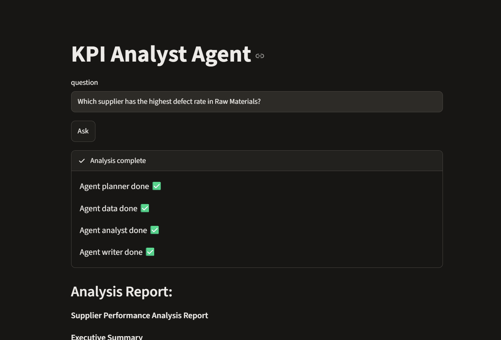
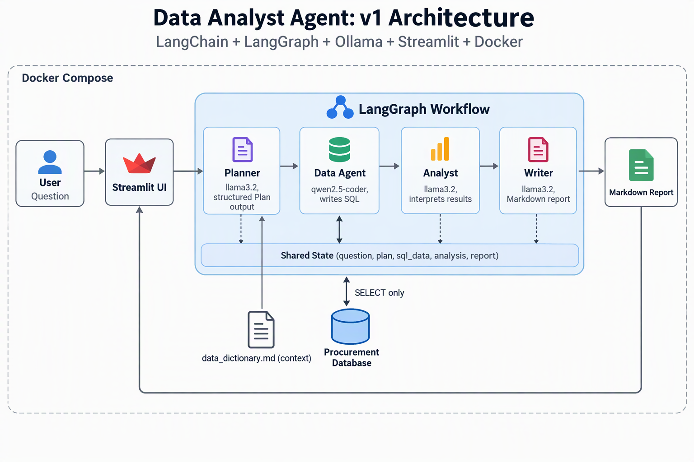

# KPI Data Analyst Agent

A multi-step LLM agent workflow that answers procurement KPI questions from a database. Ask a question in plain English, and the agent plans the analysis, writes its own SQL, interprets the results and produces a Markdown report.

Built with **LangGraph**, **Ollama (local models)**, **Streamlit** and **Docker**.

> **Status: v1.** The core workflow runs end to end. It has no accuracy evaluation yet, so treat its answers as drafts to verify.

## What it does

Example question:

> Which supplier has the highest defect rate in Raw Materials?

The agent then:

1. **Plans**: forms one testable hypothesis and breaks the analysis into small steps.
2. **Queries**: writes and runs SQL for each step against the procurement database.
3. **Analyzes**: interprets the query results against the hypothesis.
4. **Reports**: writes a Markdown report with the findings.

The Streamlit UI shows each agent finishing live, then displays the final report.

## Architecture

All agents share one state object (`question`, `plan`, `sql_data`, `analysis`, `report`). Each node reads what it needs from the state and returns only what it produced.

| Node | Model | Job |
|---|---|---|
| Planner | `llama3.2` | Produces a structured `Plan` (hypothesis, assumptions, reasoning, steps) |
| Data Agent | `qwen2.5-coder` | Turns each plan step into SQL and runs it |
| Analyst | `llama3.2` | Interprets the results against the hypothesis |
| Writer | `llama3.2` | Writes the final Markdown report |

## Tech stack

- **Orchestration:** LangGraph, LangChain
- **LLMs:** Ollama, running locally (`llama3.2`, `qwen2.5-coder`), so no data leaves your machine and there are no API costs
- **Data:** SQL database with a `procurement_kpi` table (sample data)
- **Structured output:** Pydantic models
- **UI:** Streamlit
- **Packaging:** Docker Compose